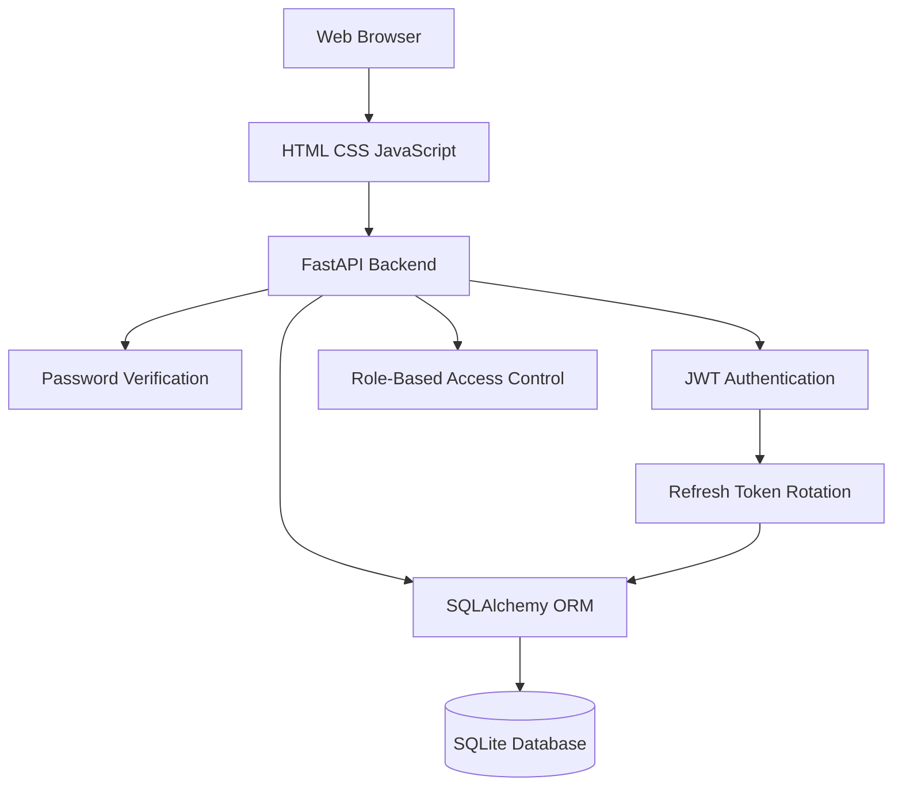

# AuthSecure — Full-Stack Authentication System

A full-stack authentication and session management application built using Python, FastAPI, SQLAlchemy, SQLite, and JavaScript.

## Project Overview

AuthSecure demonstrates the implementation of modern authentication mechanisms, secure password storage, token-based authentication, session management, and role-based access control.

## Features

- User registration and login
- Argon2id password hashing
- JWT access token generation and verification
- Protected API endpoints
- SQLite database integration
- Refresh token generation and rotation
- SHA-256 refresh token hashing
- HttpOnly cookie-based session management
- Automatic session restoration
- Server-side refresh token revocation
- Role-Based Access Control (RBAC)
- Administrator-only API endpoint
- Responsive login and registration interface
- Interactive API documentation using Swagger UI

## Technology Stack

| Component | Technology |
|---|---|
| Backend | Python, FastAPI |
| Frontend | HTML, CSS, JavaScript |
| Database | SQLite |
| ORM | SQLAlchemy |
| Authentication | JWT, PyJWT |
| Password Security | Argon2id, pwdlib |
| Web Server | Uvicorn |
| Configuration | python-dotenv |

## System Architecture



## Project Structure

```text
AuthSecure/
├── static/
│   ├── index.html
│   ├── style.css
│   └── script.js
├── main.py
├── database.py
├── models.py
├── security.py
├── requirements.txt
├── .env.example
├── .gitignore
└── README.md
```

## API Endpoints

| Method | Endpoint | Description |
|---|---|---|
| GET | / | Application status |
| GET | /health | Server health check |
| POST | /register | Register a new user |
| POST | /login | Authenticate user and issue tokens |
| GET | /dashboard | Protected user dashboard |
| POST | /refresh | Renew access token |
| POST | /logout | Revoke refresh token |
| GET | /admin/users | Administrator-only user list |
| GET | /website | Authentication website |

## Installation and Setup

Clone the repository and open the project directory.

Create a virtual environment:

```bash
python -m venv venv
```

Activate the environment on Windows:

```powershell
.\venv\Scripts\Activate.ps1
```

Install dependencies:

```bash
python -m pip install -r requirements.txt
```

Generate a JWT secret and create the environment file:

```bash
python -c "import secrets; from pathlib import Path; Path('.env').write_text('JWT_SECRET_KEY=' + secrets.token_hex(32) + '\n')"
```

Start the application:

```bash
python -m uvicorn main:app --reload
```

Open the application:

- Website: http://127.0.0.1:8000/website
- API documentation: http://127.0.0.1:8000/docs

## Security Implementation

- Passwords are stored as Argon2id hashes.
- Access tokens are signed using HS256.
- Refresh tokens are hashed before database storage.
- Refresh tokens are rotated after successful renewal.
- Refresh credentials are stored in HttpOnly cookies.
- Protected endpoints validate JWT signatures and claims.
- Administrator permissions are checked server-side.
- Secret keys and local databases are excluded from Git.

## Current Limitations

This project is a local development implementation and is not yet production-ready.

- HTTPS and secure production cookies are pending.
- Access tokens remain valid until expiration after logout.
- Full refresh token reuse detection is pending.
- Comprehensive authorization and security testing is pending.

## Future Enhancements

- Google OAuth integration
- Visual administrator dashboard
- PostgreSQL integration
- Automated API testing
- Rate limiting
- Docker containerization
- CI/CD integration
- Production deployment

## Learning Outcomes

- Backend API development
- Frontend and backend integration
- Authentication and authorization
- Database modeling and migration
- Secure credential management
- Session lifecycle management
- API debugging and testing
- Git version control
